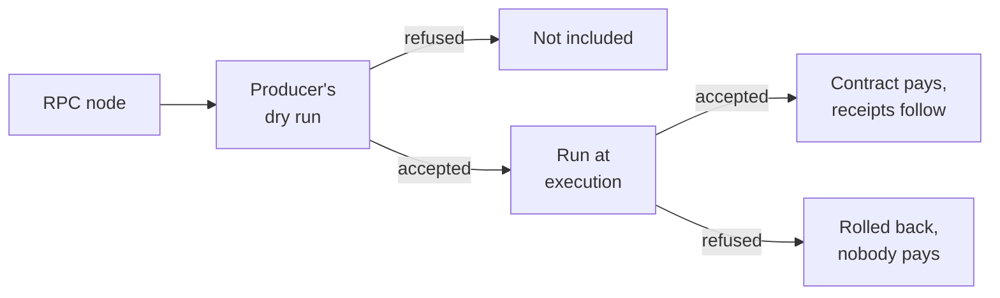

## Summary

An external call is a new kind of transaction that calls a contract, and that contract authorizes and pays for it. The call carries the contract's account id, an input and an optional state init, but no NEAR public key. The protocol checks no signature. The contract's one reserved method, `__external_call`, checks the input, which usually holds a signature and a nonce. If the method returns without failing, the contract accepts the call and pays from its own balance.

This lets a user with no account, no tokens and no relayer reach a contract. The contract sets its own rule, so any signature scheme its code can check works. A keyless universal account ([NEP-655](https://github.com/near/NEPs/blob/master/neps/nep-0655.md)) funded by a transfer can get its code from its first call's state init and run that call.

The cost is that nodes run contract code before anyone pays, in place of the signature check they run for a signed transaction. A refused call costs nobody: it burns no gas. Three bounds keep that work small: 20 Tgas per run, one call per contract per chunk, and chunk limits on all external calls together.

## Motivation

Some users cannot send a signed transaction, because of three limits. The account must exist first, with an access key on it. The signer's account pays the gas, so a user with no NEAR needs someone else to sign and pay: a relayer, through a meta transaction. Only an access key can authorize. A passkey cannot sign a NEAR transaction, because P-256 is not a NEAR key type.

The two existing ways around these limits each carry a cost. Meta transactions ([NEP-366](https://github.com/near/NEPs/blob/master/neps/nep-0366.md)) need a funded relayer and a key the user already holds. The ETH wallet contract ([NEP-518](https://github.com/near/NEPs/blob/master/neps/nep-0518.md)) fixes one authorization scheme in the protocol, so a new scheme needs a protocol upgrade.

| | Signed transaction | Meta transaction ([NEP-366](https://github.com/near/NEPs/blob/master/neps/nep-0366.md)) | ETH wallet ([NEP-518](https://github.com/near/NEPs/blob/master/neps/nep-0518.md)) | External call |
|---|---|---|---|---|
| Accounts needed | The signer's, with a key | The user's, with a key; a funded relayer's | The user's `0x` account; a relayer's | The called contract's, funded |
| Who pays | The signer | The relayer | The user's `0x` account, which signs the relayer's transaction | The called contract |
| Who authorizes | An access key | An access key of the user | The wallet contract, with an Ethereum signature | The contract's `__external_call`, with any check its code runs |
| A new scheme needs | A protocol upgrade | A protocol upgrade | A protocol upgrade | New contract code |

A wallet contract can already verify its own signature scheme, such as a passkey or another chain's signature. But its owner's credential is not a NEAR key, so the owner cannot send it a transaction. A relayer has to sign one and pay for it. An external call removes the relayer: anyone sends it, and the wallet checks the credential and pays from its own balance.

To be free of a relayer from the start, the wallet must also be created without one. A universal account ([NEP-655](https://github.com/near/NEPs/blob/master/neps/nep-0655.md)) funded by a plain transfer, such as an exchange withdrawal, is uninitialized. It has no key to sign its state init. The first external call carries that state init. It installs the wallet's code and runs its `__external_call` in the same call, paid from the transferred balance. Every later call uses the installed code, with no state init.

## Specification

The keywords "MUST", "MUST NOT", "REQUIRED", "SHALL", "SHALL NOT", "SHOULD", "SHOULD NOT", "RECOMMENDED", "MAY", and "OPTIONAL" in this document are to be interpreted as described in [RFC 2119](https://www.ietf.org/rfc/rfc2119.txt).

One protocol feature, `ExternalContractCalls`, gates every rule below. Before the protocol upgrade, the validity checks refuse an external call with `InvalidTransactionVersion`, and a chunk carrying one is invalid.

### The call

#### The call's fields and envelope

An external call is a second kind of entry in a chunk's transactions. It has no field for a public key, nonce or signature, and none for actions, deposit, gas or a block hash. Any signature goes inside the payload. It has three fields:

- `contract_id`: the one account that authorizes, pays for and receives the call.
- `payload`: opaque bytes, which the protocol never parses.
- `state_init`: optional, described below.

An external call goes to the shard of `contract_id`, and only that shard's chunks include it.

Nobody signs the call, so any node it passes through can change any field. It therefore carries only fields a change cannot exploit. The contract checks the payload. Pointing the call at another contract gains nothing if that contract's check rejects input it did not authorize. The state init is checked against `contract_id` ([State init](#state-init)). We recommend that the input carry a signature over its exact bytes, all checked by the contract. The signed bytes should cover the chain id, `contract_id`, a nonce and an expiry.

Chunks, state witnesses and network messages hold a `TransactionEnvelope`, with one arm for each kind. A signed transaction keeps its exact bytes, which start with the length of the signer's account id, at most 64, or a small version number. An external call starts with the escape byte `0xFF`, then its own version, so the two kinds add versions independently.

```rust
pub enum TransactionEnvelope {
    /// Encoded exactly as `SignedTransaction`, no discriminant.
    Signed(SignedTransaction),
    /// Encoded as 0xFF, then the external call's version, then its fields.
    Unsigned(EccTransaction),
}

/// Version 0 of an external call.
pub struct EccTransaction {
    /// The contract that authorizes, pays for and receives the call.
    contract_id: AccountId,
    /// Opaque input, decoded by the contract.
    payload: Vec<u8>,
    /// A universal account's state init, as in NEP-655.
    state_init: Option<RawStateInit>,
}
```

#### State init

The state init is a field of the call, installed only on an uninitialized universal account, before `__external_call` runs. It holds the raw bytes of the account's `UniversalStateInit`, installed by [NEP-655](https://github.com/near/NEPs/blob/master/neps/nep-0655.md)'s rules. Each node checks the state init as it checks a `UniversalStateInit` action to `contract_id`. It must derive to `contract_id` and decode, so only that account's own state init is accepted. At execution, a call that fails these checks gets a failed outcome, and its chunk stays valid. A call never creates an account. A missing account, or an uninitialized one with no state init in the call, fails with `ContractNotFound { contract_id }`. A client gets this error when it sends the call, or later in the call's outcome.

The state init is charged only when it initializes the account and the run accepts the call. A refused call rolls the install back, and nobody pays. Its fees are those of a `UniversalStateInit` action to the account itself, and they count inside the 20 Tgas budget. A call whose fees reach that budget fails with `GasExceeded` before the install. Storage staking for the installed state comes from the account's balance.

A state init on an initialized account is ignored for free. It still gets the checks above, so a malformed one fails the call. It is not installed, costs no gas, and leaves the account's state as it is. Charging it would let any node on the call's path make the contract pay more. Producers SHOULD strip it before inclusion.

When a state init is installed, it counts inside the call's own limits. These are the 20 Tgas budget ([Execution](#execution)), the 20 KiB call size and the 20 KiB of state reads. An ignored state init counts only toward the call size. The limits a `UniversalStateInit` action puts on data entries and keys do not apply, since the 20 Tgas budget keeps an installed state init far smaller. `__external_call` does not learn whether a state init preceded it. Approving without knowing is safe: only one state init derives to the account, and it installs only on an uninitialized account ([Security Implications, Re-initialization](#re-initialization)).

#### Copies and the unique id

A call can be included more than once. Each inclusion is a copy, with or without its state init. Several copies may land in different chunks, but a chunk holds at most one call to a contract. A copy with the state init and one without are two calls to that contract, so a chunk holding both is invalid.

The protocol keeps no record of the calls it ran, so it does not stop copies in later chunks. Nodes SHOULD drop a repeat of a call whose accepted copy is in a final block at most 1000 blocks old, best effort. This is not a validity rule. A contract that cares still keeps a nonce in its own state and checks it in the input, so only the first copy is accepted. A copy that lands anyway still runs: the contract refuses it, nobody pays, and its compute counts toward its chunk's limits. An honest producer's dry run sees the first copy's changes, and leaves a later copy out.

A call goes to one shard, and at most one copy runs in a chunk. So the height of the block that includes a copy tells copies apart. Each copy's unique id, which is its outcome id, combines that height with the call's hash without the state init:

```
call hash = sha256(0xFF || version || borsh(contract_id) || borsh(payload) || borsh(state_init = None))
unique id = sha256(call hash || height as u64 little endian)
```

The call hash covers the escape byte and the version, so a later version of the call never shares an id with this one.

The state init is left out, so a call has one id per height whether a producer kept or stripped its state init. The sending RPC node then finds the copy by the call's hash, whether or not a producer stripped the state init. The chunk's `tx_root` leaf still hashes the whole call, state init included, as for a signed transaction.

Like a receipt id, the unique id is not unique across forks. Copies in two forks at one height share it: hash(C, 100) in blocks 100 and 100'. A lookup returns the copy on the node's canonical chain. `tx` by unique id returns the copy as it ran, with its state init included or stripped.

### Execution

A contract authorizes an external call in its own code and pays for it after the run. The call runs twice, where a signed transaction's signature is checked: once when the producer packs it, and once when the chunk is executed.

#### Authorization

An external call runs one reserved method, `__external_call`, and the contract accepts the call by returning from it without failing. Any failure refuses the call. Each contract has at most one such method, and an external call reaches nothing else. The contract decides what to do from its input. The check is the contract's own code, reading its own storage and the raw input bytes. An ordinary function call to `__external_call` fails with `ReservedMethodName` before any code runs, whichever way it was sent.

The run may do anything an ordinary call does. It reads and writes the contract's state, and it can create promises with any action, including `AddKey`, a deploy, a transfer, a stake or `DeleteAccount`. Passing the check therefore has the power of a full access key, and the developer exposing `__external_call` is responsible for what it calls. These promises run only after the call is accepted, so the decision cannot depend on their results.

The run follows the same rules as an ordinary function call. It runs where a signed transaction's signature is checked, so it sees the chunk's parent block, as the signature check does. It also has no intermediate receipt. A signed transaction becomes a receipt carrying its signer, key, deposit and prepaid gas, while an external call runs directly. With no signer public key and no prepaid gas as well, some host functions behave differently from ordinary calls in the same chunk:

| Host function | In the run | Why |
|---|---|---|
| `signer_account_pk` | Fails with `ProhibitedInExternalCall`, in every receipt of the chain of calls it starts too | No key exists |
| `signer_account_id` | The contract | The contract authorized the call |
| `predecessor_account_id` | Fails with `ProhibitedInExternalCall` | No calling account exists |
| `refund_to_account_id` | The contract | The contract pays, so refunds return to it |
| `attached_deposit` | 0 | The call carries no deposit |
| `account_balance` | Higher than what remains after the call: the gas the run owes is not yet subtracted | An ordinary call prepays its gas; here the gas is charged from the balance after the run |
| `prepaid_gas` | Fails with `ProhibitedInExternalCall` | The call declares no gas |
| `promise_batch_action_function_call_weight` | Weight ignored: each function call promise gets only its static gas | There is no prepaid gas to split; a promise with 0 gas fails the whole call with `FunctionCallZeroAttachedGas` |
| `promise_yield_create`, `promise_yield_create_with_id` | Fail with `ProhibitedInExternalCall` | The id returned must match at the dry run and at execution |
| `promise_yield_resume`, `promise_yield_resume_with_yield_id` | Allowed, unchanged | It returns no new id to the contract, so nothing has to match at both runs, unlike `promise_yield_create` |
| `random_seed` | Fails with `ProhibitedInExternalCall` | The parent block's seed is public before sending, so a sender could grind it |
| `block_index`, `block_timestamp`, `epoch_height`, `validator_stake`, `validator_total_stake` | From the chunk's parent block and its epoch | The block the signature check sees |

A unit test in nearcore guards each new host function: it fails until the new function's behaviour in an external call is decided.

An external call does not combine with delegate actions or gas keys. No host function creates a delegate action, and an external call is not an action, so no delegate action wraps one. An external call never spends a gas key ([NEP-611](https://github.com/near/NEPs/blob/master/neps/nep-0611.md)), though its promises may add or fund one, as any contract's can.

#### Limits on the run

Each call has its own limits, and all external calls in a chunk have a limit together. That limit is a maximum, not room set aside for them. Compute and state reads are checked before each call. So the last call to start can pass either chunk limit by its own usage, at most ~75 Tgas and 20 KiB:

| Resource | Per call | All external calls in a chunk | Of the chunk's limit |
|---|---|---|---|
| Gas and compute | 20 Tgas of gas burnt | ~400 Tgas of compute | 40% of the compute limit |
| State reads | 20 KiB | ~200 KB | 5% of the storage proof soft limit |
| Transaction size | 20 KiB, state init included | ~100 KB | 2.5% of `combined_transactions_size_limit` |
| Number of calls | - | 100 | - |

The 20 KiB of state reads counts only what `__external_call` reads. Each `storage_remove` counts 2,000 bytes toward it, so a run can remove only a few keys. The 20 Tgas also covers the call's fees and loading the contract's code.

A chunk fits 5 worst-case calls, by size and by compute, since a 20 Tgas run can cost up to ~75 Tgas of compute. It fits ~10 typical post-quantum wallet calls, each taking around half of every cap. How much state a regular call reads is harder to estimate, since it depends on the trie's shape.

Producers and validators check these limits with the same code, so an honest producer's chunk usually does not fail them at execution. A malicious producer could still pack an oversized chunk, or calls whose reads bloat the state witness. So the total transaction size of the external calls in a chunk is checked upfront, and a chunk over it is invalid. A chunk with more than 100 external calls is invalid too, however small, and so is one with two calls to the same contract. State reads cannot be checked upfront. Each read is checked before it happens, from the length of the value, since one read could otherwise overshoot the state witness by 4 MiB.

A call goes through these steps in order:

1. Before the chunk runs, the validity checks: the call's size, the total size and number of the chunk's external calls, and at most one call per contract.
2. Before this call runs: a state init that is not that account's own, or does not decode, gives `ActionsValidation`. Then there must be room left in the chunk limits for compute and state reads. Else `ExternalCallChunkShareReached`.
3. The account: it must exist and cover the static fees, a state init's install fees included. Its state init is installed, and it must have code. Else `ContractNotFound` or `NotEnoughBalance`, or `GasExceeded` when the fees reach the 20 Tgas budget.
4. `__external_call` runs, with its gas and state reads checked against the per-call limits as it goes. A run past its state reads fails with `RecordedStorageExceeded`.
5. The storage staking check and the charge, else `LackBalanceForState` or `NotEnoughBalance`.

A chunk holding a call that fails step 1 is invalid. A call that fails step 2 gets a failed outcome and does not run. A failure at any step from 3 on refuses the call. Everything is rolled back, the state init included, and nobody pays. An accepted call pays at step 5: the gas its run burnt and the gas attached to its promises, from the contract's balance. Both are priced as for a signed transaction, and together they are at most 1 Pgas, as for an ordinary call. The charge comes before any promise runs, so a run that deletes its contract still pays.

#### The two runs and their outcomes

A call runs twice. The producer's dry run decides whether to include it in a chunk. The run at execution decides whether it takes effect, and validators check that run. At execution, external calls run in chunk order before the chunk's receipts, as signed transactions do.



| Where the call stops | Outcome under the copy's unique id | Counts toward the chunk limits |
|---|---|---|
| Refused in the producer's dry run | None: the call is not included | Nothing |
| Refused at execution, as the chunk limits are used up | Failure, with `ExternalCallChunkShareReached` | Nothing |
| Refused at execution, before the run, for another reason | Failure, with the error of the step that refused it | Compute, and state reads from step 3 on |
| Refused at execution, in or after the run | Failure, with the error and the run's logs, under the usual log limits | Compute and state reads |
| Accepted at execution | Success, with the return value, the logs and the receipts its promises become | Gas, compute and state reads |

No refused call burns gas: nobody pays for it, so it must not raise the gas price. At execution, every included call gets an outcome. An accepted call's state changes carry the cause `ExternalCallProcessing { transaction_id }`.

The call itself gets no receipt. Its promises become ordinary receipts, except that:

- Their predecessor and signer are the contract.
- They run in a later chunk, even one to the contract itself.
- Their `authorization_context` says `ExternalContractCall` in place of an access key. Every receipt in the chain of calls inherits it, gas refunds included. Deposit refunds and the beneficiary transfer of `DeleteAccount` come from `system`, as for a signed transaction.
- Refunds of unused gas go back to the contract. A failed promise's deposit is refunded as for any promise the contract makes.

### Inclusion and RPC

#### Sending, forwarding and the pool

A client sends an external call as it sends a signed transaction, through `send_tx` or the broadcast methods. `send_tx` takes the call in the field `external_call_base64`, in place of `signed_tx_base64`. Before pooling or forwarding the call, the RPC node checks it as it checks a signed transaction. It checks the call's size and its state init ([Execution, steps 1 and 2](#limits-on-the-run)). A node that tracks the contract's shard also runs the account checks of step 3.

| Method | Returns for an external call |
|---|---|
| `send_tx`, `wait_until` INCLUDED+ | The copy's outcome, with its unique id, once included |
| `broadcast_tx_commit` | The copy's outcome, with its unique id, once included |
| `broadcast_tx_async` | `null`, since the id depends on the height the copy lands at |
| `send_tx`, `wait_until` NONE | No outcome, as for a signed transaction |

A waiting method cannot know the unique id up front, since it depends on the block that includes the copy. An RPC node that tracks the contract's shard keeps, in memory, the external calls of the blocks it applies, by the call's hash without the state init. A waiting `send_tx` looks the call up there, and returns the outcome of the copy that landed, with its unique id. If the client sends the same call again, `send_tx` finds the copy that already landed under the same hash, and returns it. When that copy was accepted, nodes do not pass the repeat on, so it does not land again.

This is best effort. A node that restarts forgets the calls it kept. A node without the contract's shard forwards the call and returns `DOES_NOT_TRACK_SHARD` at once, without the unique id. The sender then finds its copy itself, by trying one candidate id per height.

Refusals work as for signed transactions. A call the RPC node refuses gets its error at once. A call the producer's dry run refuses is never included, so a waiting method times out. A developer can see why first, with a view call of `__external_call`.

Each node SHOULD also apply three limits of its own:

- Forwarding: at most 100 external calls among the 1000 forwarded transactions it accepts between two blocks.
- Pool: external calls take at most 10% of the pool's size limit. That is a maximum, not room set aside. The protocol promises no order between calls to one contract. A producer takes contracts in a random order, one call each, so junk sent to one contract does not hold back calls to others.
- Packing time: a producer packs signed transactions first. Then it spends up to 100 ms on external calls, of the 200 ms it has to process all transactions.

Operators can set the pool limit or the packing time to 0 to turn external calls off. These are `ecc_pool_size_share` and `ecc_time_share` in the node's config. Packing signed transactions first gives them the first pick of the chunk, but only by default: validators do not check it.

A producer packs at most one call per contract per chunk, a protocol rule ([Execution, step 1](#limits-on-the-run)). It SHOULD strip a state init sent to an initialized account. A chunk holding a copy with the state init and one without is invalid, as it holds two calls to one contract.

Under Spice, a contract has one call in flight, from a passed dry run until its block is certified. So a change someone paid for invalidates at most one call per contract. The dry run sees the last certified state plus the uncertified chunks queued after it, the same for every producer of the shard. A chunk whose external calls exceed the size limit is caught where its body is decoded. Spice's design executes such an invalid chunk as empty.

#### RPC, views and indexers

Clients look up a call's result by its unique id, in the existing request fields. Requests carry no kind, and the node tries the id as a signed transaction's hash first.

| Method | Request | Response for an external call |
|---|---|---|
| `tx`, `EXPERIMENTAL_tx_status` | `tx_hash`: the unique id; `sender_account_id`: the contract | The call as it ran, its outcome and receipts |
| `light_client_proof` and its `EXPERIMENTAL_` aliases | `transaction_hash`: the unique id; `sender_id`: the contract | A proof of the call's outcome |
| `EXPERIMENTAL_receipt_to_tx` | The receipt id | `transaction_hash`: the unique id; `sender_account_id`: the contract |

Three views show the call and what it did, in RPC results and in the indexer's messages. Every transaction view now carries `kind`: `"signed"` for a signed transaction, which keeps its other fields, and `"external_call"` for an external call. An external call has `contract_id`, `payload`, `transaction_id`, which holds the unique id, and `state_init`. `state_init` holds the state init's bytes in base64, or `null` when the call carries none. `payload` is base64 too. JSON without `kind` reads as a signed transaction, so data written before the upgrade still decodes. The view has no field for the call's hash, since `tx` does not take it.

| View | Where it appears | What changes |
|---|---|---|
| Transaction | `chunk`: `transactions`<br>`tx`, `EXPERIMENTAL_tx_status`: `transaction`<br>`send_tx` waiting, `broadcast_tx_commit`: `transaction`<br>Indexer: `shards[].chunk.transactions[].transaction` | `kind` in every transaction. For an external call: `"kind": "external_call"`, `contract_id`, `payload`, `transaction_id` and `state_init` |
| Receipt | `chunk`: `receipts`<br>`EXPERIMENTAL_receipt`<br>`EXPERIMENTAL_tx_status`: `receipts`<br>Indexer: `shards[].chunk.receipts`, `shards[].receipt_execution_outcomes[].receipt` | `authorization_context` in every action receipt. A receipt a signed transaction started keeps `signer_public_key` and shows `{"AccessKey": "<public key>"}`. One an external call started shows `"ExternalContractCall"` and has no `signer_public_key` |
| State change | `EXPERIMENTAL_changes`, `EXPERIMENTAL_changes_in_block`<br>Indexer: `shards[].state_changes` | A new cause, `ExternalCallProcessing { transaction_id }`, for the changes an external call made |

`EXPERIMENTAL_protocol_config` shows the 20 Tgas budget in `runtime_config.wasm_config.limit_config.max_gas_burnt_external`. It shows the other limits for external calls in `runtime_config.external_calls_config`, with each chunk share as a `[numerator, denominator]` pair. A view call of `__external_call` through `query` or `EXPERIMENTAL_call_function` runs the call as the producer's dry run would. `args` is the payload, and the view call's optional `state_init` field carries the call's state init. Nothing is saved. An accepted call returns its return value and logs. A refused call returns the error `EXTERNAL_CALL_REFUSED`, with the reason and the logs.

The indexer streams an external call in `shards[].chunk.transactions[]`, like a signed transaction, with the view described above as its `transaction`. Its `outcome.execution_outcome.id` is the same unique id as `transaction_id`. Each receipt an external call creates reaches the indexer as an incoming receipt of a later chunk. The Rosetta RPC in nearcore shows an external call's change to its contract's balance as one transfer, as it does for a contract's run.

Every client or indexer that reads these structures needs to update for them:

- The transaction in a chunk, a `tx` result or an indexer message, which now carries `kind` and is either kind.
- The receipt's signer key: an external call's receipts, gas refunds included, have no `signer_public_key`, only `authorization_context`.
- The state change cause, which has the new variant `ExternalCallProcessing`.
- The error enums. `InvalidTxError` has the new variants `ContractNotFound` and `ExternalCallChunkShareReached`, and `ActionErrorKind` has `ReservedMethodName`. The new host errors `ProhibitedInExternalCall` and `DepositInExternalCall` reach clients as `FunctionCallError::ExecutionError` strings. No valid call raises `DepositInExternalCall`, which only guards against a bug.
- The query error `EXTERNAL_CALL_REFUSED`, for a view call of `__external_call`.
- The `broadcast_tx_async` result, which is `null` for an external call.

## Reference Implementation

External calls are implemented in nearcore behind `ProtocolFeature::ExternalContractCalls`, and stabilized in the nearcore 2.15 release. The tracking issue is [near/nearcore#16423](https://github.com/near/nearcore/issues/16423). The changes:

- [#16521](https://github.com/near/nearcore/pull/16521) the transaction envelope for external calls.
- [#16522](https://github.com/near/nearcore/pull/16522) the runtime mode for external calls.
- [#16624](https://github.com/near/nearcore/pull/16624) the reserved method `__external_call`.
- [#16619](https://github.com/near/nearcore/pull/16619) the pool made generic over its items.
- [#16620](https://github.com/near/nearcore/pull/16620) external calls in the transaction pool.
- [#16735](https://github.com/near/nearcore/pull/16735) accepting and forwarding external calls on RPC nodes.
- [#16736](https://github.com/near/nearcore/pull/16736) packing external calls into chunks within a limit.
- [#16737](https://github.com/near/nearcore/pull/16737) the per-chunk limit at execution.
- [#16682](https://github.com/near/nearcore/pull/16682) running external calls during chunk execution.
- [#16775](https://github.com/near/nearcore/pull/16775) the limits on each external call and on each chunk.
- [#16781](https://github.com/near/nearcore/pull/16781) the producer's dry run.
- [#16795](https://github.com/near/nearcore/pull/16795) the dry runs of early preparation, on the parent's new state.
- [#16784](https://github.com/near/nearcore/pull/16784) receipts after an external call.
- [#16791](https://github.com/near/nearcore/pull/16791) the status of an external call over RPC.
- [#16810](https://github.com/near/nearcore/pull/16810) state init in an external call.
- [#16831](https://github.com/near/nearcore/pull/16831) the view call of `__external_call` as a dry run, and `send_tx` by the call's hash.
- #TODO stabilization behind `ProtocolFeature::ExternalContractCalls`.

End-to-end tests: the testloop tests in [`ecc_submission.rs`](https://github.com/near/nearcore/blob/master/test-loop-tests/src/tests/ecc_submission.rs) and [`ecc_reserved_method.rs`](https://github.com/near/nearcore/blob/master/test-loop-tests/src/tests/ecc_reserved_method.rs).

An example wallet contract, inspired by the near/intents wallet contract, will be linked here once published: TODO.

## Security Implications

### Unpaid work

#### Transaction invalidation

An external call's run takes the place of a signed transaction's signature check. Both are work nobody pays for when they fail. Anyone can send a transaction with a bad signature, and anyone can send an external call the contract refuses. The run can cost up to 20 Tgas of gas and ~75 Tgas of compute. The per-call and chunk limits cap it ([Execution, Limits on the run](#limits-on-the-run)). A chunk producer also limits how long it spends on external calls, and can turn them off ([Inclusion and RPC, Sending, forwarding and the pool](#sending-forwarding-and-the-pool)).

A call that passed the dry run can still be refused at execution, unpaid, if the contract's state changed in between. Without Spice, both runs see the same state, except at an epoch start. Its first chunk updates validator accounts before any transaction, and the dry run does not. So a staking pool whose `__external_call` checks its own balance can pass the dry run and then fail, at most once per epoch.

Under Spice, the dry run sees the last certified state and the chunks queued after it. A receipt the producer cannot see yet, such as one from another shard, can change the contract's state before the call runs. Its sender paid for that receipt. Each contract has one call in flight ([Inclusion and RPC](#inclusion-and-rpc)), so such a receipt invalidates at most one call. The worst case is a redeploy of a global contract used by account id. It can invalidate the call in flight of every contract using that code.

Anyone can send calls that contracts refuse, at no cost, and fill the node limits for external calls. Honest external calls can then wait or be dropped. Signed transactions are not affected, since external calls have their own share of each node limit and of the chunk.

#### Junk from a malicious producer

A malicious producer can skip the dry run and pack calls that contracts refuse, or calls to accounts with no contract. Validators run each one unpaid, and the state each call reads goes into the state witness. This is similar to a malicious producer packing invalid signed transactions.

Four chunk limits for external calls bound this junk ([Execution, Limits on the run](#limits-on-the-run)):

- Count: at most 100 external calls. A chunk with more is invalid.
- Chunk space: ~100 KB of external calls.
- CPU: ~400 Tgas of compute, counting every call let in under it.
- Witness size: ~200 KB of state reads, reading each account included.

Without these limits, junk could fill a whole chunk: ~1000 Tgas of compute and a ~4 MB storage proof, all unpaid. With them, junk takes at most ~40% of the compute and ~5% of the storage proof ([Execution, Limits on the run](#limits-on-the-run)).

#### Pre-empted or reworded calls

A producer or another node on the call's path can keep a sender's call out of a chunk, or change its id:

- A producer can pack its own junk call to a contract in place of a victim's call to it. A chunk holds one call per contract, so the victim's call is left out of that chunk.
- Any node that passes on a JSON payload can add whitespace or reorder keys, with the same meaning to a lenient parser. If the contract accepts it, it pays for the longer call, up to the 20 KiB cap. The reworded call also gets a new unique id, so the sender's id finds nothing.

A pre-empted call gets no outcome in that chunk. It can land in a later one, as a signed transaction left out of a chunk can. Each junk call blocks at most one honest call, the one to the same contract in that chunk. We recommend that the input not be JSON. With a canonical binary encoding such as borsh, signed over the exact bytes, a reworded payload fails the contract's check. The call is refused, and nobody pays.

### Existing contracts

#### `signer_account_id` is the contract

The promises of an external call name the contract as their signer. A contract further down the chain that charges, refunds or trusts the signer acts on the contract that accepted the call. Checks such as "signer equals predecessor", or `signer_account_id() == current_account_id()`, pass.

At the time of writing, no deployed contract was found where this harms anyone else. This holds while an external call can reach only `__external_call`. Allowing other methods means checking this again ([Future possibilities](#future-possibilities)).

#### Cross-contract calls with default gas

near-sdk's `ext()` attaches 0 static gas by default, so such a call from `__external_call` fails the whole call unless the contract sets its static gas.

#### `__external_call` exported before the upgrade

Nothing stops a deploy from exporting `__external_call` before `ExternalContractCalls`. From the upgrade on, any external call reaches it, and its contract pays for each call that returns without failing.

Each such call is paid from that contract's own balance, so it harms only that contract. The name is announced in this NEP and in the release notes. At the time of writing, a scan of mainnet and testnet found no contract exporting it.

#### TODO(security): withheld findings

- TODO(security): placeholder for a security finding; see https://near.zulipchat.com/#narrow/channel/610512-nearone.2Funiversal-ids-.26-external-calls/topic/ECC.20compatibility.20check/near/636843191

### Limits a wallet depends on

A wallet with no access key reaches its code only through `__external_call`. If its run outgrows the per-call limits, every call to it is refused, and its funds are stuck. Later versions may raise these limits, but never lower them. The per-chunk limits can change, as long as each still fits one call at its per-call limits. A wallet should keep its run well below each limit, since the trie can grow deeper at any time.

Each contract takes one external call per chunk, which slows a contract that many users share. Such a contract should be sharded instead, since one contract's state eventually outgrows the protocol limits.

### Replay and copies

#### Replay and second copies

The call carries no nonce and no block hash. Anyone can resend an accepted payload later, on another chain too, and copies can land in different chunks ([The call, Copies and the unique id](#copies-and-the-unique-id)). The contract stops this itself, with a nonce and an expiry in its signed input ([The call, The call's fields and envelope](#the-calls-fields-and-envelope)). The input also names the chain, so it fails on another one.

#### Re-initialization

After `DeleteAccount`, a transfer recreates the account as uninitialized, and its state init, which anyone can resend, sets it up again with the original data. A wallet nonce kept only in that data starts over, so every payload the wallet accepted can replay, paid by the account.

So a wallet contract should not keep its nonce only in its initial data. It sets its nonce floor to the block height of its first call. After a re-initialization the floor starts higher, so payloads signed before the deletion are refused. An expiry alone protects only the payloads that have already expired. The example wallet in Reference Implementation will do this.

#### A copy's id from the RPC node

A wallet computes a signed transaction's hash before sending. A copy's unique id needs the height the copy landed at, so the wallet takes it from its RPC node's answer. That node can drop the call or return a fake id. `tx` on a fake id answers unknown, as for a call not landed yet, and a wallet that trusts the answer waits or resends.

The wallet can find its copy without that answer. It holds the call's hash without the state init. So it tries one candidate id per height since sending, on any node or through an indexer. This works even if a node added or stripped the state init, since the id does not depend on it. A third party that needs assurance runs its own node or uses `light_client_proof`. A payload with an expiry bounds this search. The sender stops at the expiry, since a contract that checks it refuses any later copy.

## Alternatives

### How the contract authorizes and pays

The contract accepts by returning from `__external_call` without failing, and pays after the run ([Execution, Authorization](#authorization)). The check reads the contract's own storage, where a wallet keeps its current keys. We rejected a separate store for the check, which the contract's methods cannot write. A wallet could then never replace a key.

We rejected an `accept_external` host function. The contract would call it partway through the run, and pay from then on, even if the run later fails. Returning without failing accepts only once the whole run has passed. We also rejected gas declared in the call. Outside the payload nobody signs it, so any node it passes through could change it. Inside the payload, the protocol would impose a format on bytes it otherwise never parses.

We rejected charging a refused call. A malicious producer could then drain a contract it dislikes, by including calls without running the contract. Since nobody pays for a refused run, the authorization run's gas limit stays small, at 20 Tgas. We rejected one limit for both the authorization run and the promises it creates. A limit large enough for the promises would let a refused run burn that much unpaid.

### The contract's one entry point

An external call reaches one reserved method, `__external_call`, and an ordinary call to it fails ([Execution, Authorization](#authorization)). One method is the simplest choice. It can grow into several methods later, but several could not shrink back to one without breaking contracts.

Letting external calls reach any method, behind an `is_external` check, would surprise developers. A method that works for ordinary calls could fail when called externally, with no warning at build time. Existing methods also take JSON arguments, which any node on the call's path can reword ([Security Implications, Pre-empted or reworded calls](#pre-empted-or-reworded-calls)).

Marking functions for external calls, for example with tags in a wasm custom section, would be fragile. Tools strip custom sections, so a marker could be lost, and the compiled contract cache would change. Several entry points, with names the contract declares, remain a possible follow-up ([Future possibilities](#future-possibilities)).

### Copies of one call and their ids

The same call can land more than once, in different chunks, and each copy runs ([The call, Copies and the unique id](#copies-and-the-unique-id)). If the contract accepted every copy, repeated copies could drain it. So the contract should keep a nonce in its own state and check it in the payload. It accepts the first copy and refuses the rest, and nobody pays for those.

The protocol could stop copies itself, but each way fails. Running each call once would mean keeping every included call hash in state forever. A nonce field in the call, checked by the protocol, would stop nothing, since nobody signs the call. Anyone could resend the same payload with the next nonce. The protocol could read the nonce from the payload instead. It would then also have to check the signature over it, which fixes one signature scheme. Leaving the scheme to the contract is one of the goals of external calls ([Motivation](#motivation)).

Each copy gets its own unique id, from the height it lands at. With the call hash as the outcome id, two copies in different blocks would share one id. A tool that takes one hash as one transaction, such as a bridge, could then pay out twice. If the unique id included the state init, a producer could change the id by adding or stripping the state init. The sender would no longer find the copy's id from the call it sent and the height.

### The call's shape

An external call is a new kind of transaction with its own fields ([The call, The call's fields and envelope](#the-calls-fields-and-envelope)). It carries only the contract, an input and an optional state init.

We rejected reusing the signed transaction, with special values in the fields an external call has no use for. The signer, for example, would hold a placeholder account such as `ecc`. Inside the protocol, a transaction goes to its signer's shard, so every external call would go to `ecc`'s shard instead of the contract's. In views, explorers would show an `ecc` account sending every external call.

We also rejected an action list, a block hash or a salt in the call. Nobody signs the call, so any node it passes through could change any of them.

### What the run shows where no public key exists

`signer_account_id` returns the contract ([Execution, Authorization](#authorization)). That is safe, since the contract authorized the call ([Security Implications, `signer_account_id` is the contract](#signer_account_id-is-the-contract)).

No key signs the call, so `signer_account_pk` fails with `ProhibitedInExternalCall`. It fails in the run and in every receipt of the chain of calls the run starts. Receipts in that chain carry `ExternalContractCall` in place of a key.

We rejected returning a placeholder key. An all-zero key already marks a refund from `system`. Contracts that use the key as an identity would also see every external call as one signer. A made-up key would read as real, and lookups by key, such as a linkdrop's, would search a key nobody holds. We also rejected a host function that tells a contract how its chain of calls started. A contract should not depend on that.

### What the views show

We rejected replacing `signer_public_key` with `authorization_context` in every receipt view. That would break every tool that reads receipts, even one that never meets an external call.

The external call's view has no `signer_id`. A parser that reads `signer_id` from every transaction would otherwise take an external call for a signed transaction.

Existing request and response fields keep their hash names, and hold the unique id for an external call. This keeps the changes clients make small. An id field can be added beside each of them later, without breaking anyone.

## Future possibilities

### RPC and tooling

`tx` could take the call's hash in place of a unique id. The node would keep an index from each hash to the copies that landed under it. `tx` would then return every copy with its height and outcome, or wait until one lands. A sender would find its copy without trying one candidate id per height. This helps most after a `send_tx` timeout, when the sender cannot tell whether its call was refused or landed. A waiting `send_tx` would then also follow the call on a node without the contract's shard. `broadcast_tx_async` would then return the call's hash.

A contract-standard NEP could fix one payload layout for wallet contracts, while leaving the signature scheme open. The layout would carry a nonce and an expiry, and name the scheme beside the signature. A wallet app could then build a payload for any wallet contract that follows the layout. An explorer could decode the payload and show its nonce and expiry. The example wallet's payload can be a starting point ([Reference Implementation](#reference-implementation)).

### Throughput

A contract could take more than one external call per chunk, and under Spice more than one in flight. A wallet that needs higher throughput would gain from this. Even before that, such a wallet can use gas keys ([NEP-611](https://github.com/near/NEPs/blob/master/neps/nep-0611.md)), under Spice too.

Two changes could give faster errors or fewer unpaid runs. RPC nodes could run a call before forwarding it, so a refused call gets an error at once instead of a timeout. This costs RPC node CPU, unpaid when the call is refused. A producer could also send its refusal reason back to the RPC node that forwarded the call, best effort.

Each contract could also get a fair share of the external call limits, in each chunk and in the pool. One busy contract would then leave room for the others. The hard part is closing every way one contract could take more than its share. A fair share would also slow down a busy contract that is honest.

### What the run can do

A host function could return the gas left under the 20 Tgas authorization budget. A gas price host function would let a contract refuse a call when gas costs too much. Until then, an expiry in the payload limits how long the price can change. A contract can already cap the gas a call costs it, by checking `used_gas` against a limit in its payload before returning.

A contract could declare a total gas for its promises, for example in a wasm custom section. That gas would be split by weight on top of each promise's static gas. Contracts written for ordinary calls, which split their gas by weight, would then work unchanged.

Host functions that fail in the run could be allowed later. `promise_yield_create` needs an id that is the same at both runs. `random_seed` could be offered too, and guarding against a sender who grinds the seed would be the contract developer's job.

`signer_account_pk` could be deprecated, since it fails in every receipt an external call starts. The receipt view's `signer_public_key` would then go too, leaving `authorization_context`.

The one reserved method could grow into several entry points that only external calls reach, with names the contract declares. ABIs and explorers would then show which code external calls reach.

### Who pays

A later version could let another account pay for an external call, as a relayer pays for a delegate action. The idea comes from Ethereum's [EIP-8141](https://eips.ethereum.org/EIPS/eip-8141), where one account approves the call and another approves paying for it.

It would be a new version of the call that names the payer. The contract's `__external_call` accepts the call first. The protocol then calls the payer's new entry point, next to `__external_call`, which approves paying. Only such calls reach that entry point. Both run in the chunk that runs the call, so the payer would live on the contract's shard. If either refuses, everything is rolled back and nobody pays.

The contract that accepts the call would stay its signer, so its promises see the same signer as in this version.

Calls of this version keep working as before, and a contract takes calls with a payer only if it opts in.

## Consequences

### Positive

- A user with no account, tokens or relayer can reach a contract. A universal account funded by a transfer, with no keys yet, gets its wallet code from its first external call.
- A wallet contract with its own signature scheme works without a relayer.

### Neutral

- A contract's own code, not an access key, authorizes the call and pays for it.
- The contract takes on checks the protocol runs for signed transactions: the signature, replay protection and expiry ([Security Implications, Replay and copies](#replay-and-copies)).

### Negative

- Nodes run contract code before anyone pays, bounded by the chunk limits for external calls ([Security Implications, Unpaid work](#unpaid-work)).
- The protocol grows more complex, with a second kind of transaction that runs contract code on its own limits. Every node, client and tool that reads, builds or sends transactions must handle it.

### Backwards Compatibility

- An existing contract reached by an external call's promises sees the calling contract as the signer, and `signer_account_pk` fails in it ([Execution, Authorization](#authorization)).
- Indexers, RPC clients and other tools that read the chain must upgrade for the new structures ([Inclusion and RPC, RPC, views and indexers](#rpc-views-and-indexers)).
- Views of signed transactions and their receipts only gain fields, `kind` and `authorization_context`. Only a client that rejects unknown fields must change for them.
- Some tools assume a transaction's id is the hash of its body, and pass only that hash around. A copy's id also depends on the height of the block that holds it ([The call, Copies and the unique id](#copies-and-the-unique-id)). Such a tool may have no easy way to carry that extra data.
- A deployed contract takes external calls only after an upgrade to code that exports `__external_call`. An ordinary call to that name fails. At the time of writing, no contract on mainnet or testnet exports it ([Security Implications, `__external_call` exported before the upgrade](#__external_call-exported-before-the-upgrade)).
- Signed transactions keep their encoding, so chunks from before the upgrade decode unchanged ([The call, The call's fields and envelope](#the-calls-fields-and-envelope)).
- From protocol version 89, every new action receipt is an `ActionReceiptV3`, a signed transaction's included. Its view keeps `signer_public_key`.

TODO(security): placeholder for a security finding; see https://near.zulipchat.com/#narrow/channel/610512-nearone.2Funiversal-ids-.26-external-calls/topic/ECC.20compatibility.20check/near/636843191

## Unresolved Issues

None at the time of writing.

## Changelog

### 1.0.0 - Initial Version

> Placeholder for the context about when and who approved this NEP version.

## Copyright

Copyright and related rights waived via [CC0](https://creativecommons.org/publicdomain/zero/1.0/).
